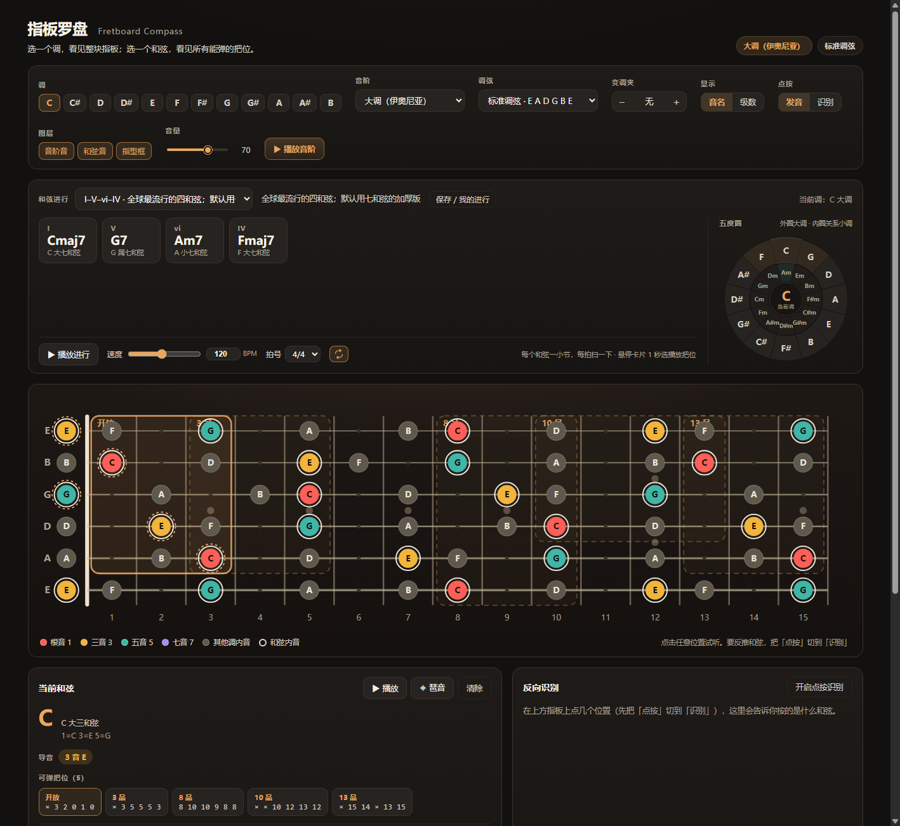

# 指板罗盘 · Fretboard Compass

把「乐理 → 指板位置」实时映射出来的吉他学习工具。

选一个调，看见整块指板上的调内音；选一个和弦，看见所有可弹的指型；点几个音，反推出这是什么和弦；再顺着和弦进行，看导音线、声部移动、借用和弦和转调建议。



## 功能

- **指板可视化**：6 弦 0–15 品，调内音按音级着色，支持音名 / 级数两种显示
- **和弦与把位**：31 种和弦类型 × 12 根音，通用搜索算出所有可弹把位
- **反向识别**：在指板上点几个音，给出 Top-5 和弦候选、转位与置信度
- **和弦进行**：36 条风格化进行；支持五度圈拖拽自建、高级替换、播放
- **播放器**：BPM / 拍号 / 循环，每个和弦可单独选播放把位
- **乐理分析**：和弦-音阶映射、导音线、声部进行、调式互换、副属和弦、转调建议
- **调弦与变调夹**：标准 / Drop D / DADGAD / Open D / FACGCE，变调夹与任意调弦正交
- **音频**：Karplus-Strong 拨弦合成，固定原声钢弦音色，全部在浏览器里离线生成
- **我的进行**：保存、载入、覆盖或另存自己的和弦进行

## 快速开始

```bash
npm install
npm run dev      # 开发服务器 http://localhost:5173
npm test         # 106 条单元测试
npm run build    # 产出单文件 dist/index.html
```

`npm run build` 会把 JS 和 CSS 全部内联进 `dist/index.html`。这个文件可以直接双击打开，不需要服务器，适合本地离线使用或拷贝给别人。

## 技术栈

Vite 5 + React 18 + TypeScript + Zustand，手写 CSS，原生 SVG 渲染指板，Web Audio 合成声音，Vitest 做测试。

`src/theory/` 是纯函数层，不依赖 React / DOM / store，可以单独复用到 CLI 或移动端。

## 文档

- [`PLAN.md`](PLAN.md)：功能范围、架构决策、实现路线与踩坑记录
- [`CLAUDE.md`](CLAUDE.md)：给 AI 协作者的硬约定与项目约定

## 验证

```bash
npm test                        # 乐理 / 音频 / 组件 / store
node scripts/audio-check.mjs    # 真实浏览器离线渲染，检查音高与自激
node scripts/dom-audit.mjs      # 指板坐标核对（需要先起 dev server）
```
